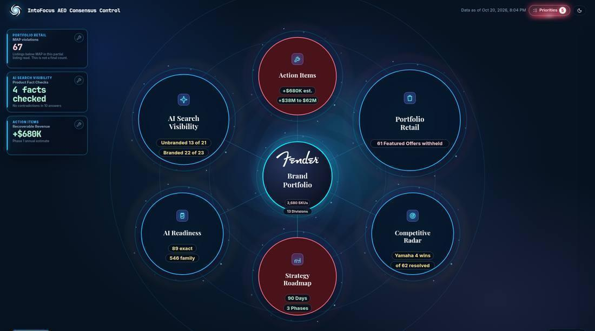

**Documentation version: 27.1**

> **Source of truth.** This FDD moved from Google Docs into the repo on 10 Nov 2026 at version 24.4. Rows by status: [register.md](register.md). Views: [cross-dashboard](cross-dashboard.md), [summary and score model](summary.md), [catalog health](catalog-health.md), [AI search](ai-search.md), [AI readiness](ai-readiness.md), [competitive radar](competitive-radar.md), [action items](action-items.md), [roadmap](roadmap.md), [minimal](minimal.md), [launch readiness and registers](launch-and-registers.md). History: [changelog.md](changelog.md). Editing rules: "Design documents" in AGENTS.md.

**INTOFOCUS AI**

**Functional Design Document**

Client dashboard for ecommerce performance and AI Consensus Truth.

| **Field** | **Value** |
|---|---|
| Version | 24.4 |
| Date | November 10, 2026 |
| Product owners | Brian Magazu, product. Brian Watson, implementation notes. |
| Example client | Fender Musical Instruments Corporation (FMIC). A pilot, not the only client shape. |
| Product verified | Worker 23.1 (the cross-dashboard foundation) was approved by Brian Magazu on 9 Nov 2026 and merged to main by PM23 (pull request 148, main c8561cb; header label 23.1 on pull request 150). Pull request 147 (main 026f3be) records the operating model and Brian's 9 Nov decisions. Workers 21.1 through 21.8 were approved by Brian Magazu on 4 Nov 2026 and merged to main by PM21 (last merge e0f91e3; header label 21.8 on pull request 136). Worker 21.1 is pull requests 127, 132, and 135. Worker 21.2 is pull requests 118 and 126. Worker 21.3 is pull request 119. Worker 21.4 is pull request 121. Worker 21.5 is pull request 122. Worker 21.6 is pull request 120. Worker 21.7 is pull requests 124 and 125. Worker 21.8 is pull requests 129 and 134. Workers 20.2 and 20.4 through 20.9 were approved by Brian Magazu on 3 Nov 2026 and merged to main by PM20 (main fff5dd2; header label 20.9 on pull request 116, commit 9cb465f). Worker 20.2 is pull requests 111 and 114. Worker 20.4 is pull request 106. Worker 20.5 is pull request 108. Worker 20.6 is pull request 107. Worker 20.7 is pull request 109. Worker 20.8 is pull request 112. Worker 20.9 is pull requests 113 and 115. Workers 18.5 and 18.6 (Brian Watson) merged on 3 Nov 2026 as pull requests 101 and 100. Worker 20.3 (pull request 110) is open and not approved. Worker 20.1 was approved by Brian Magazu on 3 Nov 2026 on pull request 105, commits 4ae1cce and a51c107. The header version label is 20.1. Workers 19.1 through 19.5 were approved by Brian Magazu on 3 Nov 2026 and published on main at aa6f29c. Workers 18.1 through 18.4 were approved by Brian Magazu on 29 Oct 2026 and published on main at 167de76. Worker 18.1 is pull request 89, commit 39a79c0, main 48875fe. Worker 18.2 is pull request 91, commits b5c44d0 and 482b92d, main eb1d9a4. Worker 18.3 is pull request 90, commits 7eecc0c and 295bcc0, main 86a5d91. Worker 18.4 is pull request 92, commits 7bf55cf and b5c6ce2, main 65e2c79. The header label is commit 193ca85. Documentation version 18.4. X-08, D-07, D-08, R-14, SC-01, SC-02, and SC-04 are CURRENT. SC-03 stays TARGET. R-18 is a new TARGET. X-03 stays REFINE. Workers 17.6 through 17.9 were approved by Brian Magazu on 29 Oct 2026 and published on main at d91bffa. Worker 17.6 is pull request 84, commits 6d87cee and a189b3f. Worker 17.7 is pull request 88, commit 921c81e. Worker 17.8 is pull request 86, commit ed72d84. Worker 17.9 is pull request 85, commit b0c368e. The header label is commit 29441ce. Documentation version 17.9. N-01, X-31, S-01, and X-28 are CURRENT. S-02 stays TARGET. Workers 17.2 through 17.5 were approved by Brian Magazu on 29 Oct 2026. Pull request 79, commit 021ba89, main 60afa6f, worker 17.2. Pull request 82, commit 429ed30, main 4cb03ee, worker 17.3. Pull request 81, commit b25aeb8, main 85e076b, worker 17.4. Pull request 80, commit 457f790, main b2aa735, worker 17.5. The header label is commit de85d24, main 27c0109. Documentation version 17.5. A-09, D-01, X-05, and N-05 are CURRENT. Worker 17.1 was approved by Brian Magazu on 29 Oct 2026 on pull request 78, commits d2cb887 and 43d7b59. Published on main at 2cb2a5a. Documentation version 17.1 records the header title IntoFocus AI Consensus Control and the version label 17.1. X-26 is CURRENT. Workers 16.1 through 16.4 were approved by Brian Magazu on 28 Oct 2026 on pull request 76 and published on main at 677f077. Pull requests 74, 75, and 77 merged with that pull request. Documentation version 16.4 records the map heroes and the removal of the catalog SKU count from the client dashboard. Worker 15.2 was approved by Brian Magazu on 28 Oct 2026 on pull request 72, commits 588be5b, 8a71fa3, and 48814d1. Published on main at 7af49b0. Documentation version 15.3 records the Catalog Health Out of Stock tab as R-17 CURRENT. Brian Magazu asked for this closeout on 28 Oct 2026. There is no worker label on that commit. Workers 13.1 through 14.4 were approved by Brian Magazu on 28 Oct 2026 on pull request 71, commit 8e70ae5. Published on main at 3b333ae. Workers 12.1 through 12.8 were approved by Brian Magazu on 27 Oct 2026 and published on main at commit dd32396. Pull request 67 is merged (commit fe4c0c4). Workers 11.5 through 11.7 remain the prior published line (main 345a755, pull request 58). Workers 11.1 through 11.4 remain on main 874c9cb (pull requests 50, 51, 52, and 53). Workers 9.1 through 10.5 remain on PR 46, commit d9911c9, 26 Oct 2026. AI Search opens on the last 30 days ending on the published run. The map shows the published run and its matching API run. |
| Primary inputs | Module 1 Optimization (Brian’s FDD Shortlist + comments); FDD Addendum Sales and CEO Feedback; Brian Magazu meeting decisions 21 Oct 2026 folded in this revision. |
| Purpose | Give executives one picture of what is live, what to adjust, what is approved next, and what still needs a decision. This document does not change the product. |

*Audience: Brian Magazu first, then other executives. Operators use the same feature IDs in the Technical Design Document.*

# Status legend

Use the word and the color together. A reader who cannot see color still has the status name. Blue text marks approved future behavior (TARGET).

| **Status** | **Meaning** |
|---|---|
| **🟢 CURRENT** | Live and verified on the desktop dashboard / live data as of this revision. |
| **🟠 REFINE** | Live, and still needs an adjustment before it is executive-clear. |
| **🔵 TARGET** | Approved direction. Not yet live. |
| **🟣 DECISION** | Requires a product choice or an approved assumption before build. |
| **⚪ LATER** | Intentionally deferred until after launch. |

**Verification is separate from product status:**

> • Verified — exercised on the running desktop dashboard, confirmed in live data, or confirmed in source for labels still present.
>
> • In review — reported by Brian, or only partly rechecked in this pass.
>
> • Not tested — described from source or comments, and not exercised in the browser.

# 1. Executive summary

The balanced hub-and-spoke view is the primary launch surface. Its six bubbles must show one AI Consensus Truth position and one ecommerce position. A satellite repeats its main bubble's figure only when that tab has no next-best figure. Three views will share the same data, period, and evidence: Minimal, Balanced, and Deep dive (deep dive depth is LATER).

AI Foundation, AI Commerce, and AI Consensus are live. AI Actuation stays TARGET. When the brand is Partner-led, the user choosing authorized sellers is R-18 CURRENT. A per-client list in the database is R-19 TARGET, before a second client. Buy Box is the primary term. Catalog Health replaces Portfolio Retail. Summary replaces Brand Portfolio. Done-Together replaces Done-for-You / Done-with-You. Suppression opportunity uses an approved 80% assumption with a visible evidence trail. Phase 1 and enterprise dollar estimates remain analyst estimates until their trails exist.

| Consensus Truth The judgment an assistant reaches for an unbranded shopping question from brand pages, marketplaces, retailers, citations, and repeated information. IntoFocus shows what drives that judgment and where the client can change how its brand is represented. |
|---|

# 2. Product goals and launch principles

| **Principle** | **Launch rule** |
|---|---|
| Show performance | Ecommerce and AI Consensus Truth are both readable from the hub. |
| Show the link | Catalog and retail conditions explain AI-search outcomes. |
| Give a next step | Every gap points to an action with ownership that is contractual, not a toggle. |
| Open the evidence | Headline → inputs, assumptions, formula, listings, source URLs. |
| Live data only | No demo value may appear as client intelligence. |
| Partial figures | Asterisk + tooltip naming missing inputs, coverage, source, last check, and effect. Or “Not available\*”. |
| One population per number | Say what was counted, out of what, and when it was checked. |
| Client commercial silence | IntoFocus fees, retainers, and fee multiples never appear. |
| Canonical words | Brian’s designated phrases are not paraphrased. Buy Box in primary copy. |
| Desktop launch | Desktop is the launch surface. Mobile is LATER. |

# 3. Users and primary workflows

| **User** | **Job on this dashboard** |
|---|---|
| Executive sponsor | Read Consensus Truth and ecommerce position in one sitting; open Opportunity and actions. |
| Ecommerce / marketing operator | Work Catalog Health, AI Search, citations, and Action Items with evidence. |
| IntoFocus analyst / PM agent | Verify findings, maintain FDD/TDD/Sheets, publish trusted runs. |

Primary path: Balanced hub → bubble → evidence → Action Items. Viewing order is decided after the six home answers are solid (LATER).

# 4. Current dashboard overview

Verified structure (21 Oct 2026 desktop pass on the local production build of cursor/terminology-batch-8c53, commit 1fdbfc0): hub map with six spokes; center node Summary; retail spoke Catalog Health with seller type Partner-led; Summary tabs Briefing, Performance, and Opportunity; AI tab Run Details; primary retail copy Buy Box. Interactive ROI is still present and empty. The product title is still “IntoFocus AEO Consensus Control” (X-26). Published GitHub Pages still serves main cfd45de until this branch deploys. Live counts below are the 21 Oct Supabase read.

*Figure 1 — Balanced hub (Oct 20 desktop). Map structure still matches. Status: 🟢 CURRENT map. H-06, H-05, R-01, A-03, and X-19 are desktop-verified on the 7.4 build. H-07 tab labels are verified; score layouts remain TARGET. Published Pages still serves cfd45de until deploy.*

| **Live population (21 Oct)** | **Count** | **Note** |
|---|---|---|
| Hub SKUs | 3,682 | Not shown on the client dashboard. The catalog total is not the population this analysis covers. |
| Division count | 6 | Not shown on the Summary bubble. This read's six divisions include accessories, so the count is not the electric-guitar subset. Meaning still REFINE. |
| Retail monitored | 1,076 | present 946 · withheld 62 · no active offer 68 |
| Spec checked | 1,024 | Separate population from retail |
| AI current run | 102 expected / 76 answered | Partial v11, published Oct 18 — client visibility of failed engines is 🔵 TARGET to hide |
